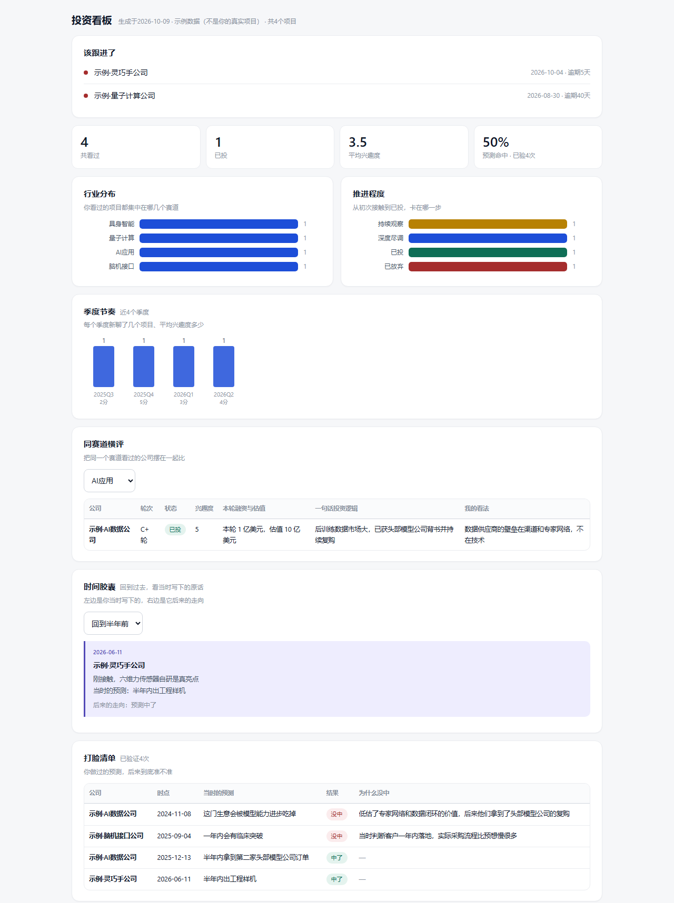

# OwnFolio投资项目记录台

**给一级市场投资人的项目记录与复盘工具。**

> OwnFolio helps early-stage investors keep a deal log and review their own judgement over time. One product, three forms: an **agent skill** (let your AI keep the log for you), a **web app** (open in any browser, nothing to install), a **desktop app** for Windows / macOS / Linux. Meanwhile, we also provide you a **static HTML dashboard** you can forward.



---

## 形态选择

| 形态       | 特点                                                     |
| -------- | ------------------------------------------------------ |
| AI Skill | 适于有Coding Plan，常用办公Agent，日常聊项目比较多，想把BP或会议纪要直接丢给它整理的投资人 |
| Web版     | 点击即用，无需安装                                              |
| 桌面版      | 跨平台分发，根据需求选择；本地模式，数据真实安全地保存在本地目录，AI调用需要接入API Key       |


---

## 形态一：AI Skill

把公司BP、会议纪要、访谈录音转写等丢给AI，说一句"录进我的项目库"。它会按22个标准字段提取，
  
缺的必填项反问你，确认后写进项目库中，同时追加一条看法流水。

- 支持飞书（电子表格/多维表格）、钉钉、本地Excel、腾讯文档等项目库
- 具体说明详见[`skill/`](skill/)

## 形态二：网页版

**点击即用，无需安装，支持端侧协同**。


- **直接用**：把 [`web/index.html`](web/index.html) 下载下来，双击用浏览器打开
- **部署成网址**：在仓库Settings → Pages里，把来源设成 `main` 分支的 `/web` 文件夹，
    
  就能得到一个 `https://你的用户名.github.io/invest-desk/` 这样的地址，手机也能直接开

数据保存在浏览器当中，如需清理浏览器，请导出备份。

手机版（窄屏自动单列）：


## 形态三：桌面版

**数据保存在本地目录**。

### 下载方式

见本仓库右侧的 **Releases**，按需挑选对应电脑配置的文件：

| 系统                    | 下载这个文件                    |
| --------------------- | ------------------------- |
| Windows               | `…-x64.exe`               |
| Mac英特尔芯片              | `…-mac-x64.dmg`           |
| Mac Apple芯片（M1/M2/M3） | `…-mac-arm64.dmg`         |
| Linux                 | `…-linux-x86_64.AppImage` |

### 安装包是怎么来的（跨平台分发）

**仓库里放的是源码，不是安装包。** 安装包太大（每个八十多兆），不适合塞进代码仓库，
  
而且不同系统的安装包必须用对应系统的机器才能打出来——尤其是Mac，必须用macOS的打包工具，
  
自动流程解决：代码推上来之后，GitHub会开三台机器（Windows、Mac、Linux）分别打包，打好之后自动挂到Releases页面上。
  
用户只需要打入版本标签。配置在 [`.github/workflows/release.yml`](.github/workflows/release.yml)。

想要自己打包也可行，在 `desktop/` 目录下：

```bash
npm ci
npm run build          # 打你当前系统能打的包
npm run build:mac      # 打 Mac 包（只能在 Mac 上跑）
npm run build:all      # 三个平台全打（只能在 Mac 上跑）
```

---

## 它真正解决的问题

大部分项目记录工具都在解决"怎么记下来"。但投资人真正的痛点不是记不住，
  
是**半年后回看时，已经想不起来当初是怎么判断的**——当时为什么看好，当时担心什么，
  
后来到底应验了没有。

所以这个工具围绕一件事设计：**让你每个时点的判断都留得住，并且能被事后打分。**

关键设计是两张表：

| 项目库（主表）          | 看法流水（流水表）           |
| ---------------- | ------------------- |
| 一个项目一行，存**现状**   | 一条看法一行，存**历史**      |
| 首次录入时新增，之后只更新这一行 | 每次看法有变就**追加**，永不改旧行 |

如果十月一号的看法被十一月的新想法覆盖掉了，你就永远不知道"我当时是不是判断错了"——
  
而这恰恰是这个工具存在的全部意义。

字段定义见 [`skill/references/schema.md`](skill/references/schema.md)。

---

## 仓库结构

```
skill/                    AI技能包：工作手册、字段定义、看板生成脚本
  SKILL.md                给AI看的工作手册
  references/             字段定义、存储适配、指标口径、提取规范
  scripts/                建库、生成看板
  examples/               示例看板和示例数据
desktop/                  桌面版源码（Electron）
  index.html              界面（单文件）
  main.js / preload.js    主进程与桥接
  app/                    数据落盘、接口登记
  scripts/make-icns.sh    生成Mac图标
web/                      网页版（单文件HTML，打开即用）
.github/workflows/        三平台自动打包配置
```

## 注意事项

- 本项目不含任何密钥、令牌、接口地址、账号，也不持有任何用户数据——没有服务器
- 如果选用AI Skill版本，项目库需要用户提供，支持Office、飞书、钉钉等；桌面版数据保存在自定义文件夹下；网页版数据保存在浏览器中，受浏览器容量限制（单个1.5MB，总共约6MB），大文件请用桌面版
- 判断是否为同一项目仅依赖公司名这一单一字段，公司名变动会生成两个不同的项目
- 时间胶囊和打脸清单依赖用户持续更新看法，只录一次不更新，回看时就没有素材

## 许可证

MIT License，见 [LICENSE](LICENSE)。转发请保留署名。
