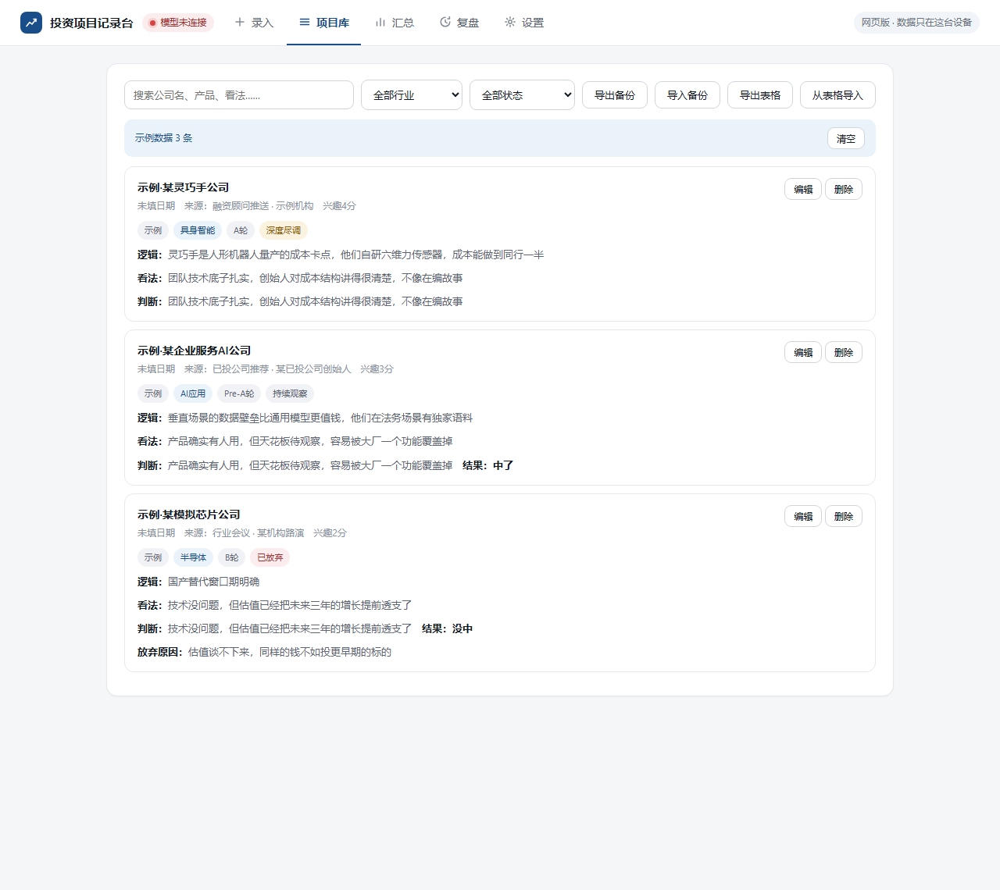
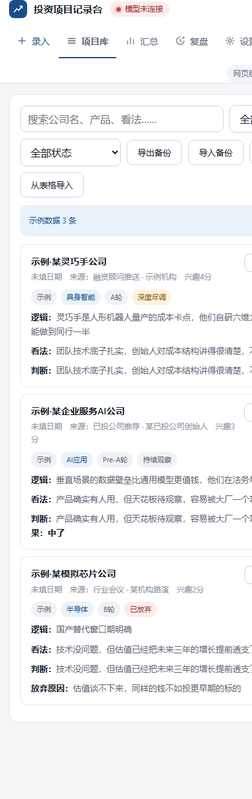

# 📈 OwnFolio — Deal Log & Judgement Review for Early-Stage Investors


**An open-source toolkit that helps early-stage investors keep a deal log and grade their own judgement over time.**

> Most deal trackers solve "how do I write it down". That is not the hard part. Six months later you cannot remember *why* you liked a company, what you were worried about, or whether any of it turned out to be true. OwnFolio is built around one thing: **every judgement you make stays on the record, dated, and can be graded later.**


## 🤔 What is this? (TL;DR)

**OwnFolio** is a free, open-source toolkit for early-stage investors. Pick the form that fits how you work — an **agent skill**, a **web app**, or a **desktop app** — and log deals as you meet them. It keeps one row per company (current state) and one append-only row per judgement (history), so your past calls survive long enough to be scored.

## ❓ FAQ

**Do I have to install anything?**
  
No, not if you don't want to. The web app is a single HTML file — download it and double-click. The desktop app is optional and has a portable build with no installer.

**Where does my data live?**
  
With you, always. It depends on the form: your own spreadsheet (agent skill), your browser (web app), or a folder you pick on your own disk (desktop app). This project has **no server, no database and no account**.

**Which libraries can it write to?**
  
Feishu (Sheet and Bitable), DingTalk, local Excel / CSV, and Tencent Docs. See [`skill/references/storage-adapters.md`](skill/references/storage-adapters.md).

**Can I just hand it a pitch deck or a transcript?**
  
Yes — that is what the agent skill is for. It extracts **22 standard fields**, comes back to you about the required ones it could not find, and writes only after you confirm.

**Does it work on my phone?**
  
The web app does. It collapses to a single column on narrow screens and can be added to your home screen.

**Is it free?**
  
Yes. MIT licensed, fully open source. Nothing to sign up for, nothing to pay for.

## 🆚 A plain spreadsheet vs. OwnFolio

| A plain spreadsheet                                  | With OwnFolio                                                         |
| ---------------------------------------------------- | --------------------------------------------------------------------- |
| One row per deal, overwritten when your view changes | Two tables: current state **plus** an append-only judgement log       |
| Old views vanish the moment they are replaced        | Every past call kept verbatim, with the date you made it              |
| "Was I wrong?" is impossible to answer later         | Judgements can be graded — hits, misses, and why                      |
| Extraction from a deck or transcript is manual       | The agent skill extracts 22 standard fields, then asks about the gaps |
| Charts need a BI tool or a pile of formulas          | A zero-dependency static HTML dashboard you can forward to anyone     |
| You maintain the structure yourself                  | The schema is fixed, so metrics stay comparable over time             |

## 📦 What's inside

```
skill/                      Agent skill package
  SKILL.md                  Instruction manual the AI reads
  references/               Field schema, storage adapters, metric rules, extraction prompt
  scripts/                  Library bootstrap + dashboard rendering
  examples/                 Sample data and a sample dashboard
  assets/                   CSV headers, dashboard template, screenshots
desktop/                    Desktop app source (Electron)
  index.html                UI (single file)
  main.js / preload.js      Main process and bridge
  app/                      Persistence and interface registry
  scripts/make-icns.sh      macOS icon generator (optional)
docs/                        Web app (single-file HTML, no install)
.github/workflows/          Cross-platform build pipeline
```

## 🚀 Pick your form

| Form            | Best for                                                                          | Data lives in        |
| --------------- | --------------------------------------------------------------------------------- | -------------------- |
| **Agent skill** | You already talk to an AI about deals and want it to keep the log for you         | Your own spreadsheet |
| **Web app**     | You want zero install, and access from any browser including your phone           | Your browser         |
| **Desktop app** | You want files on your own disk, and care about attachments and long-term storage | A folder you choose  |

### Option 1 — Agent skill

Drop a pitch deck, meeting notes or an interview transcript on your AI and say *"log this into my deal library"*. It extracts the 22 standard fields, asks you about the required ones it could not find, writes the row after you confirm, and appends a judgement entry at the same time.

```bash
git clone https://github.com/Renard-SAIF/OwnFolio.git

# then copy the skill folder into your agent's skills directory, for example:
cp -r OwnFolio/skill ~/.workbuddy/skills/ownfolio    # WorkBuddy
cp -r OwnFolio/skill ~/.claude/skills/ownfolio       # Claude Code
```

On first run it will ask **where your deal library is** and remember the answer. Full guide: [`skill/SKILL.md`](skill/SKILL.md).

### Option 2 — Web app

**Nothing to install. Works in any modern browser.**



- **Just open it** — download [`docs/index.html`](docs/index.html) and double-click it.
- **Or host it** — in your repo go to **Settings → Pages**, set the source to the `main` branch and the `/docs` folder, and you get a URL like `https://<your-username>.github.io/OwnFolio/` that works on your phone too.

Data is stored in your browser. **Export a backup before clearing browser data.**



### Option 3 — Desktop app

**Your data stays in a folder on your own disk.**

Grab the build for your machine from **Releases**:

| System                          | Download                  |
| ------------------------------- | ------------------------- |
| Windows                         | `…-x64.exe`               |
| macOS, Intel                    | `…-mac-x64.dmg`           |
| macOS, Apple silicon (M1/M2/M3) | `…-mac-arm64.dmg`         |
| Linux                           | `…-linux-x86_64.AppImage` |

#### Where the builds come from

**This repo holds source, not binaries.** Each installer is around 80 MB — too heavy for a code repo — and more importantly a macOS installer can only be produced on a macOS machine. **A Windows PC cannot build one.**

So a pipeline does it instead: push a version tag and GitHub spins up three machines — Windows, macOS and Linux — builds on each, and attaches the results to the Release. The config lives in [`.github/workflows/release.yml`](.github/workflows/release.yml).

To build locally, from `desktop/`:

```bash
npm ci
npm run build          # builds for the machine you are on
npm run build:mac      # macOS only
npm run build:all      # all three platforms, macOS only
```

## 🎯 Usage

Talk to it the way you already talk:

- *"Log this pitch deck into my deal library."*
- *"Add today's call notes — my concern is now go-to-market, not the tech."*
- *"What did I think about this company six months ago?"*
- *"Render this quarter's dashboard."*
- *"Which of my calls didn't hold up?"*

## 🧠 The core design: two tables

| Deal library (master)                               | Judgement log (append-only)                                           |
| --------------------------------------------------- | --------------------------------------------------------------------- |
| One row per company, holds **current state**        | One row per judgement, holds **history**                              |
| Created on first entry, updated in place after that | Appended every time your view changes — **old rows are never edited** |

> If your October view is overwritten by your November view, you can never know whether you were wrong — and that is the whole reason this tool exists.

Field definitions: [`skill/references/schema.md`](skill/references/schema.md). Metric definitions: [`skill/references/analysis-rules.md`](skill/references/analysis-rules.md).

## ⚠️ Good to know

- **No keys, tokens, endpoints or accounts.** No server, and this project never holds your data.
- **You bring the library.** The agent skill writes to a library you already have (Feishu, DingTalk, local Excel, Tencent Docs…). The desktop app writes to a folder you choose. The web app writes to your browser, which is capped (~1.5 MB per file, ~6 MB total) — use the desktop app for large attachments.
- **Deals are matched on company name alone.** If a company is renamed, it becomes two records.
- **The time capsule and the miss list depend on you updating your views.** Log once and never revisit, and there is nothing to review later.

## 🤝 Contributing

PRs welcome — new storage adapters, better dashboards, clearer docs. See [CONTRIBUTING.md](CONTRIBUTING.md).

## ⭐ Star this repo

If this helps you remember why you made a call, **[star it](https://github.com/Renard-SAIF/OwnFolio)** — it helps other investors find it.

## 📄 License

[MIT](LICENSE) — use it, fork it, keep the attribution when you redistribute.

---

Made by [@Renard-SAIF](https://github.com/Renard-SAIF)
